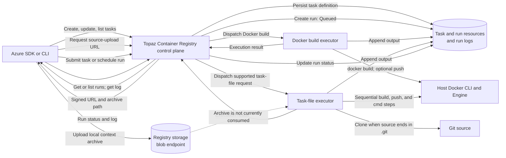

# ACR Tasks in Topaz

Azure Container Registry (ACR) Tasks define container builds and command steps associated with a registry. Topaz implements the ACR Tasks management API and can execute supported runs using the Docker CLI and Docker Engine available to the Topaz process. It does not run tasks in Azure's managed build service.

## Architecture

The client uses the Azure Resource Manager (ARM) API to manage task definitions and start runs. For a local context, Azure CLI requests a source-upload URL from Topaz, uploads the context archive to the registry's storage endpoint, and submits a run request. Topaz creates the run resource and dispatches supported work to an executor that uses the host's Docker environment. Run state and logs are available to the client through the control plane.

For the Azure CLI local-context flow, the upload and task execution are separate. Topaz provides the signed URL used for the upload, but its task-file executor does not currently read or extract that archive.
Microsoft documents [local file-system contexts](https://learn.microsoft.com/en-us/azure/container-registry/container-registry-tasks-overview#context-locations), explains that the CLI sends a build context to ACR for a quick task in its [ACR Tasks overview](https://learn.microsoft.com/en-us/azure/container-registry/container-registry-tasks-overview#quick-tasks), and describes the [`az acr run` command](https://learn.microsoft.com/en-us/cli/azure/acr?view=azure-cli-latest#az-acr-run).

## Task definitions and runs

Task definitions are registry resources. Topaz supports creating, updating, retrieving, listing, and deleting tasks. It stores task properties such as the platform, step, timeout, credentials, and trigger configuration.

A run starts when a client submits a run request for a task or schedules a registry run. Topaz creates a run resource with an identifier and status, then updates that resource as supported work executes. Clients can retrieve or list runs and request a run's log.

Topaz stores trigger configuration but does not evaluate it to start runs automatically. Submit a run request to execute a task.

## Execution paths

| Request | What Topaz does |
|---|---|
| Docker build | Runs `docker build` with the requested context and Dockerfile. If push is enabled, runs `docker push` after a successful build. An HTTP(S) context is cloned with Git first. |
| Task file from a Git source | When the source location ends in `.git`, clones it and loads the YAML at the task-file path, then executes the supported steps in listed order. |
| Task file from a local context | Azure CLI uploads the context archive to the registry storage endpoint before submitting the run. Topaz does not currently read that archive; task-file execution supports Git sources or inline task-file content instead. |
| Encoded task file | Decodes the supplied Base64 UTF-8 YAML and executes it through the same task-file path. |

Task-file steps support `build`, `push`, and `cmd`. Build and push steps invoke the corresponding Docker commands. A command that begins with `docker` or `az` invokes that host CLI; other commands run as a Docker container. Topaz logs execution output with the run.

## Requirements and limits

Docker must be installed and its Engine must be reachable by the Topaz process for actual build, push, or task-file execution. Docker runs use the host's Docker environment, not an isolated Azure build agent.

Task-file steps run sequentially. Topaz does not currently apply ACR task-file settings for conditional step ordering (`when`), retries, environment variables, values files, volumes, or secrets. These settings may be present in the YAML or request but do not change execution.

For scheduled Docker-build and task-file requests, if Topaz cannot use Docker, the compatibility path can still return a run marked `Succeeded` without executing the steps. A succeeded status in that case is not evidence that a build or task ran. See [Known limitations](../known-limitations.md) for the unsupported task-file behavior.
